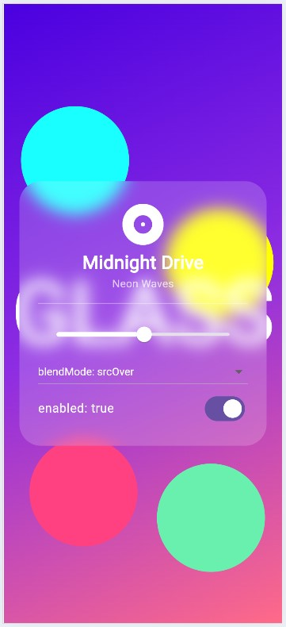

# BackdropFilter Demo: Frosted-Glass "Now Playing" Card

**`BackdropFilter`**

This is a demo app that shows a music player card with a frosted-glass look floating over colorful artworks, with live controls to change the widget's properties.

## Screenshot



## How to Run

Requirements: [Flutter SDK](https://docs.flutter.dev/get-started/install) and a browser, a connected device or emulator.

```bash
git clone https://github.com/bonheurdivin/backdrop_filter_demo.git
cd backdrop_filter_demo
flutter pub get
flutter run
```

## The Three Attributes

All three are changed live with the controls inside the glass card.

### 1. `filter`
- **What it is:** The `ImageFilter` applied to the backdrop. Here it is `ImageFilter.blur(sigmaX, sigmaY)`.
- **Default:** `filter` has no default (it is required). The blur sigma values default to `0`, which means no blur at all, and it increases (becomes more blur) as you increase the sigma value, making the text and shapes behind the card less clear.
- **Why change it:** A developper might need to make/change the blur effects in order to enhance readability.

### 2. `blendMode`
- **What it is:** How the filtered backdrop is composited with the content beneath it.
- **Default:** `BlendMode.srcOver`.
- **On-screen effect:** Switching to `multiply` darkens the glass area, and `screen` lightens it.
- **Why change it:** To adjust the contrast of the glass to match the general app's theme.

### 3. `enabled`
- **What it is:** A flag that turns the filter on or off while the widget stays in the tree.
- **Default:** `true`.
- **On-screen effect:** Turning it off removes the blur setting, leaving only the semi-transparent tint.
- **Why change it:** Blurring is GPU-intensive, so you can disable it on low-end devices or while it isn't needed, without rebuilding the layout.

## Key Code

The relevant code is the `ClipRRect` + `BackdropFilter` block in [`lib/main.dart`](lib/main.dart):

```dart
ClipRRect(
  borderRadius: BorderRadius.circular(28),
  child: BackdropFilter(
    filter: ImageFilter.blur(sigmaX: sigma, sigmaY: sigma),
    blendMode: blend,
    enabled: enabled,
    child: Container,
  ),
)
```

`ClipRRect` is required because `BackdropFilter` fills all available space and would otherwise blur the entire screen.

## Project Structure

```
lib/main.dart 
test/widget_test.dart
screenshots/
```